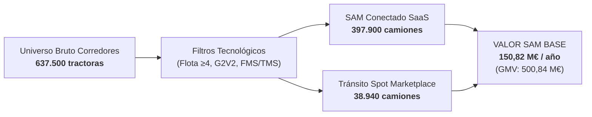

# Posta // Memorando de Inversión: Cuantificación de Mercado (TAM, SAM, SOM) y Modelo de Monetización

> **Documento de Estrategia Cuantitativa y Due Diligence Financiera**  
> **Comité de Inversión (Ronda Seed / Series A)**  
> **Compañía**: Posta (*Red Predictiva de Pernocta y Tacógrafo*)  
> **Modelo**: Híbrido B2B (SaaS Agnóstico + Marketplace Transaccional SSTPA)  
> **Fecha de Referencia**: 2026 (Costes oficiales MITMS a julio de 2026)

---

## Resumen Ejecutivo

Posta resuelve la fricción estructural entre la hiperregulación telemática del transporte pesado (obligatoriedad del **Smart Tachograph G2V2** y ventana de inspección retroactiva de **56 días**) y el déficit crítico de infraestructura segura de descanso en Europa (**390.057 plazas SSTPA en déficit**; ~73.000 en España).

Operando como una **capa de software predictivo agnóstica al hardware** integrada vía API en los sistemas FMS/TMS ya existentes en las flotas, Posta combina dos motores de ingresos:

1. **Suscripción SaaS B2B**: **19,00 €/camión/mes** (228,00 €/año en Escenario Base) para predicción de paradas y cumplimiento de tiempos de conducción y descanso.
2. **Marketplace Transaccional de Aparcamiento Seguro (SSTPA)**: Comisión (*take-rate*) del **12,0%** (3,00 €/reserva sobre ticket medio de 25,00 € netos; 48 reservas anuales = 144,00 €/año).

| Métrica Clave | Escenario Base | Rango / Impacto |
| :--- | :--- | :--- |
| **ARPU Híbrido Anual** | **372,00 € / camión / año** | 219,00 € (Conservador) – 606,00 € (Agresivo) |
| **ARPU Híbrido Mensual** | **31,00 € / camión / mes** | 18,25 € – 50,50 € |
| **Ahorro Directo en Caja Flota** | **3.572,59 € / camión / año** | Multiplicador de retorno: **9,6x** sobre gasto híbrido |
| **Valor Total Capacidad Operativa** | **4.954,44 € / camión / año** | Multiplicador de retorno: **13,3x** sobre gasto híbrido (**21,7x** sobre SaaS) |
| **TAM Bottom-Up (UE-27 + UK)** | **1.860,19 M€ / año** | Censo ajustado por parque de larga distancia (2,11M camiones) |
| **TAM Top-Down (UE)** | **2.909,23 M€ / año** | 2.395,63 M€ Cloud FMS Pesado + 513,60 M€ Comisiones Pernocta |
| **SAM (Corredores Clave)** | **150,82 M€ / año** | 397.900 camiones SaaS + 38.940 en tránsito spot (GMV: 500,84 M€) |
| **SOM Año 3 (Mes 36)** | **7,91 M€ / año** | 20.000 camiones SaaS (720 flotas) + 6.500 spot (4,56 M€ ARR + 3,35 M€ transaccional) |

---

## 1. Hipótesis de Monetización y Fijación de Precios (ARPU)

### 1.1 Benchmarks de Mercado y Posicionamiento SaaS
El transporte pesado europeo opera con tres capas tecnológicas:
* **Cumplimiento legal de tacógrafo**: VDO Fleet Tachograph Management (~6,00 €/vehículo/mes sin hardware) y Webfleet Vehicle Check (3,50 €/mes).
* **FMS intermedio**: Quartix (11,80 € – 19,00 €/mes con hardware).
* **FMS avanzado / telemática empresarial**: Webfleet (12,00 € – 41,00 €/mes más hardware LINK), Samsara (24,00 € – 59,00 €/mes en UK; 25,00 $ – 31,00 $/mes base en EE.UU.) y Trimble/Transporeon (25,00 € – 45,00 €/mes).

**Ventaja Competitiva de Posta**: 100% *Hardware-Agnostic*. Se conecta mediante API a la telemática preexistente (amparada por la directiva *EU Data Act*) y analiza en tiempo real los datos del tacógrafo inteligente G2V2. **Cero inversión en dispositivos y cero paradas de taller**.

#### Escenarios de Suscripción SaaS B2B
* **Conservador (12,00 €/mes · 144,00 €/año)**: Flotas medianas (6–20 vehículos). Conexión API G2V2, alertas ventana de 56 días y mapa de ocupación.
* **Base / Ancla Comité (19,00 €/mes · 228,00 €/año)**: Suite completa de larga distancia. Motor algorítmico multi-flota de tiempos remanentes (4,5h; 9h/10h; 56h/90h), replanificación dinámica de paradas y reserva automatizada (*autobooking*) SSTPA.
* **Agresivo / Enterprise (28,00 €/mes · 336,00 €/año)**: Grandes operadores (>20 vehículos). Integración bidireccional TMS/ERP, auditoría CMR/TAPA, reporte de emisiones CO2 (Reglamento UE 2026/1046) y bloqueo prioritario de plazas.

### 1.2 Fijación del Take-Rate en Reservas SSTPA
* **Ticket medio de pernocta**: **25,00 € netos** por noche (estándar deducible para flotas profesionales en recintos seguros certificados Bronze/Silver/Gold como mowiz TRUCK, OnTurtle, Truck Etape o Calsina Carré).
* **Take-rate modelado**: **12,0%** (3,00 € de fee neto por reserva), alineado con las comisiones del mercado europeo (SNAP, TRAVIS Road Services, Truckfly).

### 1.3 Matriz de ARPU Híbrido Consolidado

$$\text{ARPU Híbrido Anual} = \text{ARPU SaaS} + (\text{Frecuencia Anual} \times \text{Fee por Reserva})$$

| Parámetro | Escenario Conservador | Escenario Base (Ancla) | Escenario Agresivo | Fórmula / Detalle |
| :--- | :---: | :---: | :---: | :--- |
| **Cuota Mensual SaaS** | 12,00 €/mes | **19,00 €/mes** | 28,00 €/mes | Por camión activo |
| **ARPU Anual SaaS (A)** | 144,00 €/año | **228,00 €/año** | 336,00 €/año | Cuota mensual × 12 |
| **Ticket Medio Pernocta** | 25,00 € | **25,00 €** | 25,00 € | Tarifa neta media SSTPA |
| **Take-Rate Marketplace** | 10,0% | **12,0%** | 15,0% | Margen neto retenido |
| **Fee Neto por Reserva** | 2,50 € | **3,00 €** | 3,75 € | Ticket medio × Take-Rate |
| **Frecuencia de Reservas** | 30 res/año (2,5/mes) | **48 res/año (4,0/mes)** | 72 res/año (6,0/mes) | Pernoctas críticas en ruta |
| **GMV Anual Pernocta / Camión** | 750,00 €/año | **1.200,00 €/año** | 1.800,00 €/año | Frecuencia × 25,00 € |
| **ARPU Transaccional (B)** | 75,00 €/año (6,25 €/m) | **144,00 €/año (12,00 €/m)** | 270,00 €/año (22,50 €/m) | Frecuencia × Fee |
| **ARPU HÍBRIDO ANUAL (A+B)** | **219,00 € / camión** | **372,00 € / camión** | **606,00 € / camión** | SaaS + Transaccional |
| **ARPU Híbrido Mensual Equiv.** | 18,25 € / camión | **31,00 € / camión** | 50,50 € / camión | ARPU Anual ÷ 12 |

---

## 2. Modelo Cuantitativo de ROI para la Flota

Fundamentado en el **Observatorio de Costes del Transporte de Mercancías por Carretera del MITMS** (julio de 2026):
* **Coste anual camión articulado 40t (120.000 km, 1.800h)**: **170.875,68 €/año** (1,4240 €/km; 94,93 €/hora de trabajo).
* **Coste en transporte internacional (150.000 km)**: **243.601,39 €/año** (1,6240 €/km).
* **Personal de conducción + combustible**: 55.331,80 € + 54.183,47 € = **64,0% de la estructura de costes**.
* **Margen operativo sectorial**: apenas un **3,9%**, lo que hace crítica la eficiencia en ruta.

```
       ┌──────────────────────────────────────────────────────────────┐
       │             AHORRO ECONÓMICO ANUAL POR CAMIÓN                │
       ├──────────────────────────────────────────────────────────────┤
       │  1. Multas e Inmovilizaciones Evitadas:            569,03 €  │
       │  2. Bonificación Seguros + Reducción Robo:         825,53 €  │
       │  3. Optimización Desvíos (720 km + 37,5h chofer): 2.178,03 € │
       ├──────────────────────────────────────────────────────────────┤
       │  TOTAL AHORRO DIRECTO EN CAJA:                   3.572,59 €  │
       │  [Upside Capacidad Operativa MITMS (94,93 €/h): +1.381,85 €] │
       │  VALOR ECONÓMICO TOTAL INTEGRAL:                 4.954,44 €  │
       └──────────────────────────────────────────────────────────────┘
```

### Detalle de las 3 Palancas de Retorno:

1. **Multas e Inmovilizaciones Evitadas (LOTT / Ventana G2V2 56 Días)**:
   * 71.030 sanciones/año por tiempos de conducción y descanso en España (74% leves, 20% graves, 6% muy graves; importe ponderado: 362,20 €).
   * Riesgo base sin Posta: 1,80 multas/año + 25% riesgo retención en carretera (2,5h a 94,93 €/h) = 711,29 €/año.
   * Reducción del 80% mediante ruteo preventivo = **569,03 €/camión/año**.
2. **Primas de Seguro y Prevención de Siniestros (Robo de Carga y Combustible)**:
   * La UE sufre >8.200 M€/año en robos de mercancía (>58.000 incidentes TAPA EMEA); España sufre >20.000 robos/año (coste medio FENADISMER: 85.000 €).
   * Bonificación del 5% en prima anual de seguro (base MITMS 8.710,65 €) = **435,53 €/año**.
   * Reducción del 75% en siniestros menores/franquicias no cubiertas (8% prob. × 6.500 €) = **390,00 €/año**.
   * Subtotal Seguridad: **825,53 €/camión/año**.
3. **Optimización de Horas Efectivas y Supresión de Desvíos Improductivos**:
   * En 60 noches críticas al año, el chófer pierde 37,5 min buscando aparcamiento (37,5 h/año) y recorre 12 km de rodeo por noche (720 km/año).
   * **Ahorro Directo en Caja**: 720 km × 1,4240 €/km (1.025,28 €) + 37,5h × 30,74 €/h chófer (1.152,75 €) = **2.178,03 €/camión/año**.
   * **Upside Capacidad Horaria Total MITMS**: 37,5h recuperadas a 94,93 €/h íntegros = 3.559,88 €/año (+1.381,85 € de capacidad de transporte comercializable).

### Retorno sobre la Inversión (ROI Multiplier)

$$\text{ROI (Caja)} = \frac{3.572,59\ \text{€}}{372,00\ \text{€}} = \mathbf{9,6\mathbf{x}} \qquad\Big|\qquad \text{ROI (Capacidad)} = \frac{4.954,44\ \text{€}}{372,00\ \text{€}} = \mathbf{13,3\mathbf{x}}$$
$$\text{ROI sobre Cuota SaaS Base (228 €)} = \mathbf{15,7\mathbf{x}\ \text{a}\ 21,7\mathbf{x}}$$

| Dimensión de la Flota | Ahorro Directo (Caja) | Valor Capacidad Total | Coste Anual SaaS | Coste Híbrido Total | ROI Neto |
| :--- | :---: | :---: | :---: | :---: | :---: |
| **1 Camión (Unit Economics)** | 3.572,59 €/año | 4.954,44 €/año | 228,00 €/año | 372,00 €/año | **9,6x – 13,3x** |
| **Flota Mediana (15 Camiones)** | 53.588,85 €/año | 74.316,60 €/año | 3.420,00 €/año | 5.580,00 €/año | **9,6x – 13,3x** |
| **Gran Flota (50 Camiones)** | 178.629,50 €/año | 247.722,00 €/año | 11.400,00 €/año | 18.600,00 €/año | **9,6x – 13,3x** |

---

## 3. Cuantificación de Mercado: TAM (Europa: UE-27 + Reino Unido)

### 3.1 Enfoque Top-Down: Intersección FMS y Gasto en Pernocta
1. **Software Cloud FMS para Pesados**:
   $$\text{TAM FMS} = 8.340\ \text{M€ (FMS Europa 2026)} \times 63,55\%\ \text{(Cloud)} \times 45,2\%\ \text{(HDV)} = \mathbf{2.395,63\ \text{M€ / año}}$$
2. **Pool de Comisiones Marketplace Pernocta**:
   $$\text{Demanda}: 690.000\ \text{camiones/noche en ruta} \times 248\ \text{noches eq.} = 171,2\ \text{M pernoctas/año}$$
   $$\text{GMV Pernocta}: 171,2\ \text{M} \times 25,00\ \text{€} = 4.280,00\ \text{M€/año} \implies \text{Comisiones (12\%)} = \mathbf{513,60\ \text{M€ / año}}$$
3. **TAM Top-Down Consolidado**: $2.395,63 + 513,60 =$ **2.909,23 M€ / año**.

### 3.2 Enfoque Bottom-Up: Censos y Ajuste de Larga Distancia
* **Censo Total UE-27 + UK (ACEA / DfT)**: **6.825.800 vehículos pesados** (>3,5t).
* **Parque Activo de Mercancías (Eurostat / RAC)**: **4.690.000 camiones**.
* **Parque de Larga Distancia con Pernocta en Ruta**: **2.110.500 camiones** (45,0% del parque activo de mercancías).

$$\text{TAM Bottom-Up Ajustado} = (\text{Censo Universo} \times \text{ARPU SaaS}) + (\text{Camiones Larga Distancia} \times 48\ \text{res} \times 3,00\ \text{€})$$

| Universo Considerado | Conservador (219 €) | Base / Ancla (372 €) | Agresivo (606 €) | Detalle Escenario Base |
| :--- | :---: | :---: | :---: | :--- |
| **Censo Total (6,83M uds) — Ajustado LD** | 1.141,20 M€ | **1.860,19 M€ / año** | 2.863,30 M€ | SaaS: 1.556,28 M€ + Mkt: 303,91 M€ (GMV 2.532,6 M€) |
| **Censo Total (6,83M uds) — Puro 100%** | 1.494,85 M€ | **2.539,20 M€ / año** | 4.136,43 M€ | 6.825.800 camiones × 372,00 € |
| **Parque Activo (4,69M uds) — Ajustado LD** | 833,65 M€ | **1.373,23 M€ / año** | 2.145,68 M€ | SaaS: 1.069,32 M€ + Mkt: 303,91 M€ (GMV 2.532,6 M€) |
| **Parque Activo (4,69M uds) — Puro 100%** | 1.027,11 M€ | **1.744,68 M€ / año** | 2.842,14 M€ | 4.690.000 camiones × 372,00 € |

---

## 4. Cuantificación de Mercado: SAM (Corredores Prioritarios)

El SAM se concentra en tres geografías estratégicas con un universo bruto en corredor de **637.500 camiones pesados de larga distancia** sometidos a tres filtros técnicos: flotas de $\ge 4$ camiones, tacógrafo G2V2 y FMS/TMS integrable.



### Desglose de los 3 Segmentos del SAM:
1. **Segmento 1: Flota Española de Servicio Público en Larga Distancia e Internacional**:
   * 197.500 tractoras LD $\times$ 79,83% (flotas $\ge 4$) $\times$ 91,5% (G2V2) $\times$ 78,0% (FMS/TMS) = **112.525 camiones elegibles**.
   * Valor Base: **41,86 M€/año** (25,66 M€ SaaS + 16,20 M€ Mkt sobre GMV de 135,03 M€).
2. **Segmento 2: Flota Internacional Extranjera en Paso Pirenaico (AP-7 / A-1)**:
   * 8,56M cruces anuales (23.455 camiones/día; 92,2% en La Junquera e Irún) $\implies$ 110.000 camiones extranjeros únicos.
   * 110.000 camiones $\times$ 100% (G2V2) $\times$ 85,0% (flotas $\ge 4$) $\times$ 76,0% (FMS/TMS) = **71.060 camiones SaaS**.
   * Demanda transaccional spot: los 38.940 camiones restantes pernoctan en ruta (24 res/año).
   * Valor Base: **29,24 M€/año** (16,20 M€ SaaS + 13,04 M€ Mkt sobre GMV de 108,68 M€).
3. **Segmento 3: Eje Transfronterizo Francia y Benelux**:
   * 330.000 tractoras LD netas $\times$ 88,0% (flotas $\ge 4$) $\times$ 90,0% (G2V2) $\times$ 82,0% (FMS/TMS) = **214.315 camiones elegibles**.
   * Valor Base: **79,72 M€/año** (48,86 M€ SaaS + 30,86 M€ Mkt sobre GMV de 257,18 M€).

### Consolidado Económico del SAM

| Segmento | Camiones Elegibles | GMV Pernocta (Base) | SAM Conservador | SAM Base (Ancla) | SAM Agresivo |
| :--- | :---: | :---: | :---: | :---: | :---: |
| **Seg. 1: España LD/Int** | 112.525 SaaS | 135,03 M€ / año | 24,64 M€ | **41,86 M€ / año** | 68,19 M€ |
| **Seg. 2: Tránsito Pirenaico** | 71.060 SaaS (+38.940 spot) | 108,68 M€ / año | 17,02 M€ | **29,24 M€ / año** | 48,29 M€ |
| **Seg. 3: Francia y Benelux** | 214.315 SaaS | 257,18 M€ / año | 46,93 M€ | **79,72 M€ / año** | 129,88 M€ |
| **TOTAL SAM CONSOLIDADO** | **397.900 SaaS (+38.940 spot)** | **500,84 M€ / año** | **88,60 M€** | **150,82 M€ / año** | **246,38 M€** |
| *— Ingresos Recurrentes SaaS* | *397.900 camiones* | — | *57,30 M€* | ***90,72 M€ / año*** | *133,69 M€* |
| *— Comisiones Marketplace* | *20.033.760 reservas* | — | *31,30 M€* | ***60,10 M€ / año*** | *112,69 M€* |

---

## 5. Proyección Operativa y Financiera: SOM a 36 Meses

### 5.1 Estrategia Go-To-Market (GTM)
* **Target prioritario sin fricción**: Grandes flotas (>20 camiones; 2.439 empresas en España con >40% de la flota) y medianas especializadas (6–20 camiones; ~6.800 empresas con ~85.000 camiones).
* **Ciclo de venta B2B ágil**: 3 a 5 semanas (medianas) y 6 a 10 semanas (grandes) al ser integración vía API sin instalación física.
* **Alianzas multiplicadoras**: Acuerdos con patronales clave (**CETM** con 55,2% representatividad y 129.000 camiones; **FENADISMER**, **ASTIC**, **ATFRIE**) y operadores de aparcamiento (**mowiz TRUCK**, OnTurtle, TRAVIS / Bosch).

### 5.2 Trayectoria Financiera y Operativa (Escenario Base)

```
        M€
       9.0 ──┐                                                     ┌── 7,91 M€
             │                                                     │   (4,56 ARR +
       6.0 ──┤                                                     │    3,35 Mkt)
             │                                       ┌── 2,84 M€   │
       3.0 ──┤                         ┌── 0,69 M€   │             │
             │                         │             │             │
       0.0 ──┴─────────────────────────┴─────────────┴─────────────┴──
                                     Año 1         Año 2         Año 3
                                   (1.750 uds)   (7.200 uds)   (20.000 uds)
```

| Métrica Operativa y Financiera | Año 1 (Mes 12) | Año 2 (Mes 24) | Año 3 (Mes 36) |
| :--- | :---: | :---: | :---: |
| **Flotas B2B Activas Contratadas** | **85 flotas** | **290 flotas** | **720 flotas** |
| — Tamaño medio de flota | 20,6 camiones | 24,8 camiones | 27,8 camiones |
| **Camiones Conectados a SaaS** | **1.750 camiones** | **7.200 camiones** | **20.000 camiones** |
| **Camiones en Tránsito Spot (Marketplace)** | 500 camiones | 2.300 camiones | 6.500 camiones |
| **Total Camiones Monetizados** | **2.250 camiones** | **9.500 camiones** | **26.500 camiones** |
| **Cuota sobre SAM Total (397.900 uds)** | **0,44%** | **1,81%** | **5,03%** |
| **Cuota sobre SAM España (112.525 uds)** | **1,56%** | **6,40%** | **17,77%** |
| **ARR Suscripción SaaS (228 €/año)** | **399.000 € (0,40 M€)** | **1.641.600 € (1,64 M€)** | **4.560.000 € (4,56 M€)** |
| Reservas Anuales Procesadas | 96.000 reservas | 400.800 reservas | 1.116.000 reservas |
| GMV Total Pernocta Gestionado | 2.400.000 € (2,40 M€) | 10.020.000 € (10,02 M€) | 27.900.000 € (27,90 M€) |
| **Ingresos Marketplace (12% Take-Rate)** | **288.000 € (0,29 M€)** | **1.202.400 € (1,20 M€)** | **3.348.000 € (3,35 M€)** |
| — Transaccional de Flota SaaS | 252.000 € | 1.036.800 € | 2.880.000 € |
| — Transaccional de Flota Spot | 36.000 € | 165.600 € | 468.000 € |
| **FACTURACIÓN TOTAL CONSOLIDADA** | **687.000 € (0,69 M€)** | **2.844.000 € (2,84 M€)** | **7.908.000 € (7,91 M€)** |

---

## 6. Análisis de Sensibilidad (Año 3 — Mes 36)

Para contrastar el riesgo de ejecución comercial y elasticidad de precios, se evalúan tres escenarios al cierre del Año 3:

| Variable Clave (Mes 36) | Escenario Pesimista (Downside) | Escenario Base (Plan Central) | Escenario Optimista (Upside) |
| :--- | :---: | :---: | :---: |
| **Flotas B2B Activas** | 450 empresas | **720 empresas** | 1.050 empresas |
| **Camiones Conectados a SaaS** | 12.000 camiones | **20.000 camiones** | 32.000 camiones |
| **Camiones Tránsito Spot** | 3.000 camiones | **6.500 camiones** | 11.000 camiones |
| **Cuota sobre SAM Total** | 3,02% | **5,03%** | 8,04% |
| **Pricing SaaS Mensual / Anual** | 12,00 €/m (144 €/año) | **19,00 €/m (228 €/año)** | 28,00 €/m (336 €/año) |
| **Take-Rate y Fee / Reserva** | 10,0% (2,50 €) | **12,0% (3,00 €)** | 15,0% (3,75 €) |
| **Reservas / Año (SaaS / Spot)** | 30 / 15 | **48 / 24** | 72 / 36 |
| **ARPU Híbrido Anual** | 219,00 € / camión | **372,00 € / camión** | 606,00 € / camión |
| **ARR Suscripción SaaS** | 1.728.000 € (1,73 M€) | **4.560.000 € (4,56 M€)** | 10.752.000 € (10,75 M€) |
| **GMV Pernocta Procesado** | 10.125.000 € (10,13 M€) | **27.900.000 € (27,90 M€)** | 67.500.000 € (67,50 M€) |
| **Ingresos Comisiones Marketplace** | 1.012.500 € (1,01 M€) | **3.348.000 € (3,35 M€)** | 10.125.000 € (10,13 M€) |
| **FACTURACIÓN TOTAL AÑO 3** | **2.740.500 € (2,74 M€)** | **7.908.000 € (7,91 M€)** | **20.877.000 € (20,88 M€)** |

---

## 7. Tesis de Inversión y Factores de Des-riesgo

1. **Eficiencia de Capital Excepcional (CAC Reducido)**: Al ser 100% cloud agnóstica vía API, Posta no gasta en hardware ni logística física. Un equipo de 14 AEs en el Año 3 cubre la captación requerida.
2. **Defensibilidad y Efecto Red de Dos Lados**:
   * *Lado Demanda (Flotas)*: Cuantos más tacógrafos integrados, mayor precisión en el algoritmo predictivo de saturación de parkings.
   * *Lado Oferta (SSTPA)*: Los parkings maximizan su ocupación con *autobooking*, creando altas barreras de salida (*lock-in*).
3. **Viento de Cola Regulatorio Imparable**:
   * Inspección de **56 días** y Smart Tachograph G2V2 hacen insostenible la búsqueda improvisada de aparcamiento.
   * El déficit europeo de 390.000 plazas garantiza que la plaza reservada sea un recurso escaso de alto valor.
4. **Unit Economics Asimétricos**: Con un coste para la flota de 372 €/año y un ahorro directo demostrado de 3.572,59 € a 4.954,44 € (ROI de **9,6x a 13,3x**), la propuesta de valor es inmune a la volatilidad macroeconómica del transporte.
